# Quaderno Appunti

App per iPhone e iPad (SwiftUI, iOS 17+) per prendere appunti a mano, nello stile dei quaderni
digitali: Apple Pencil o dito, quaderni con copertina, PDF da annotare e ricerca nella scrittura.

## Schermate

**iPhone**

  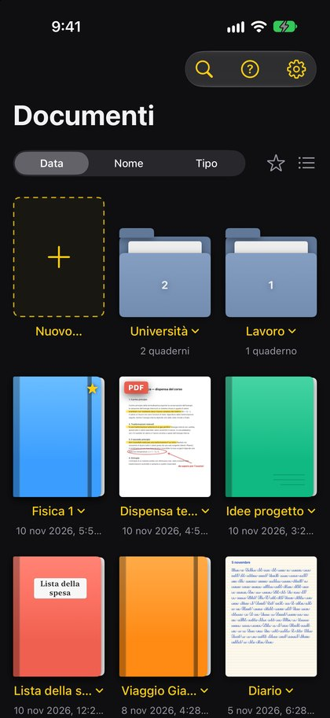
  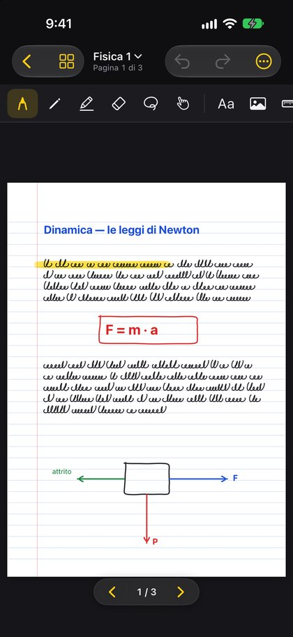
  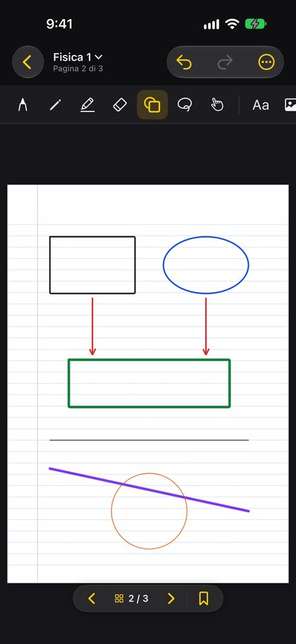
  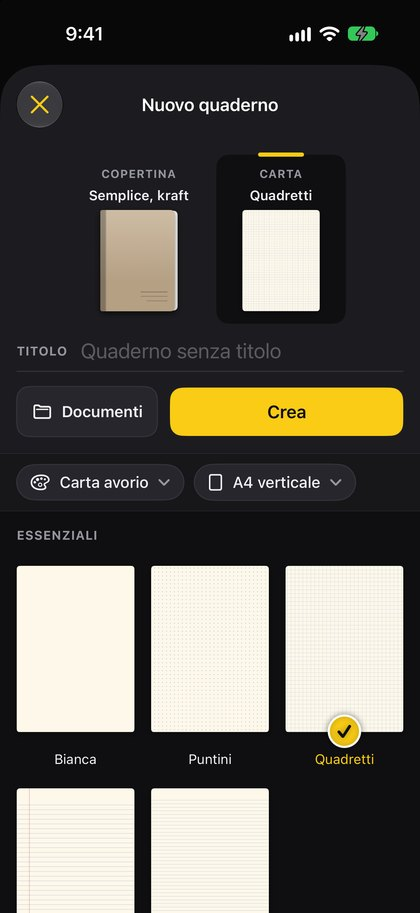
  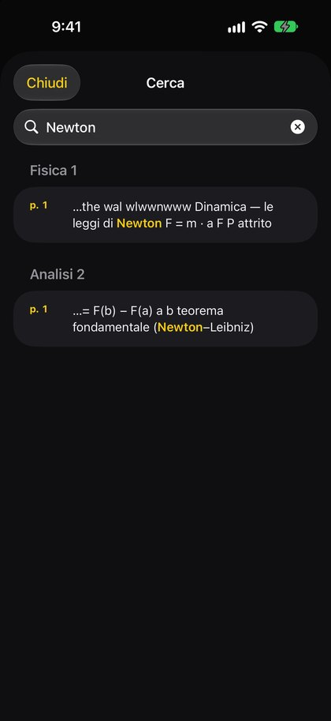
  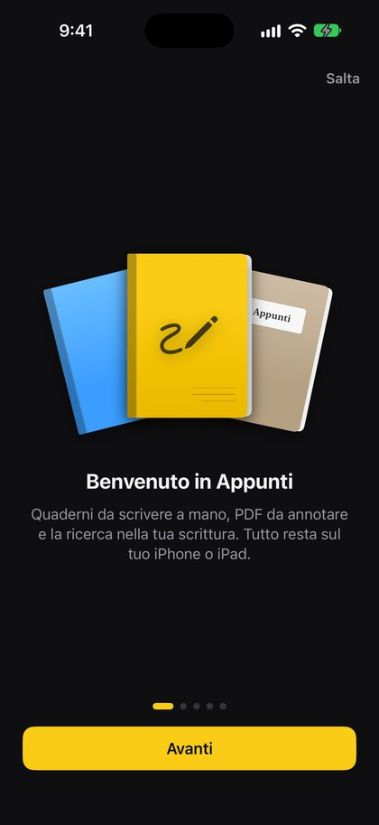

**iPad**

| | |
|---|---|
| 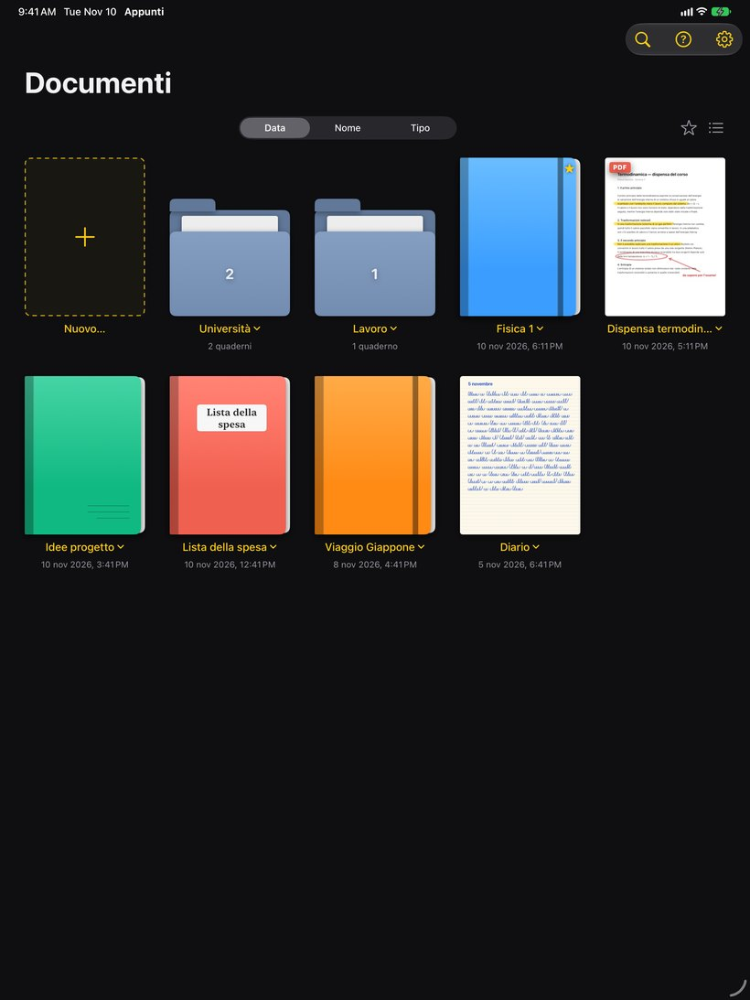 | 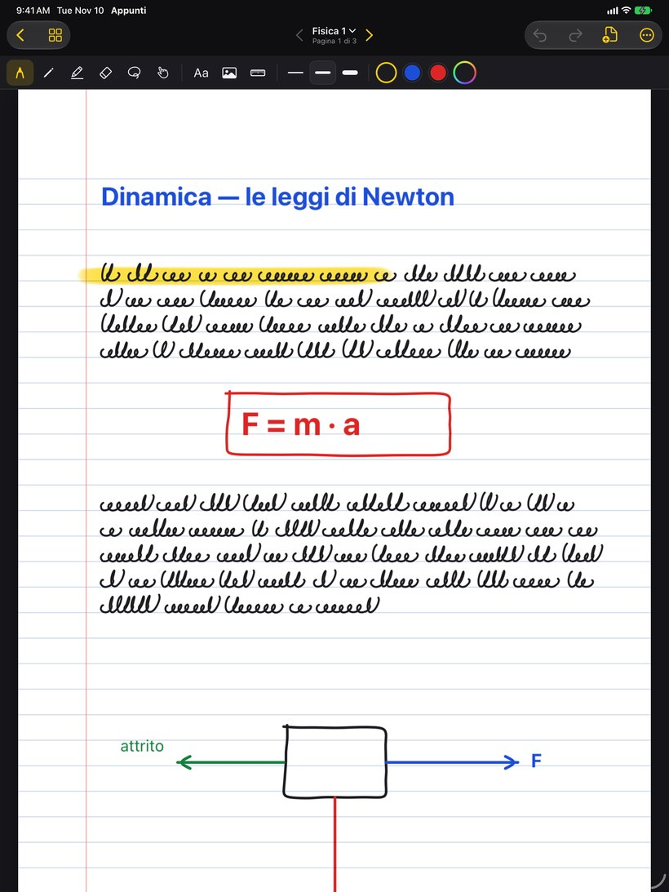 |
| Libreria: cartelle, copertine, prima pagina come copertina | Scrittura, evidenziatore, testo e disegni |
| 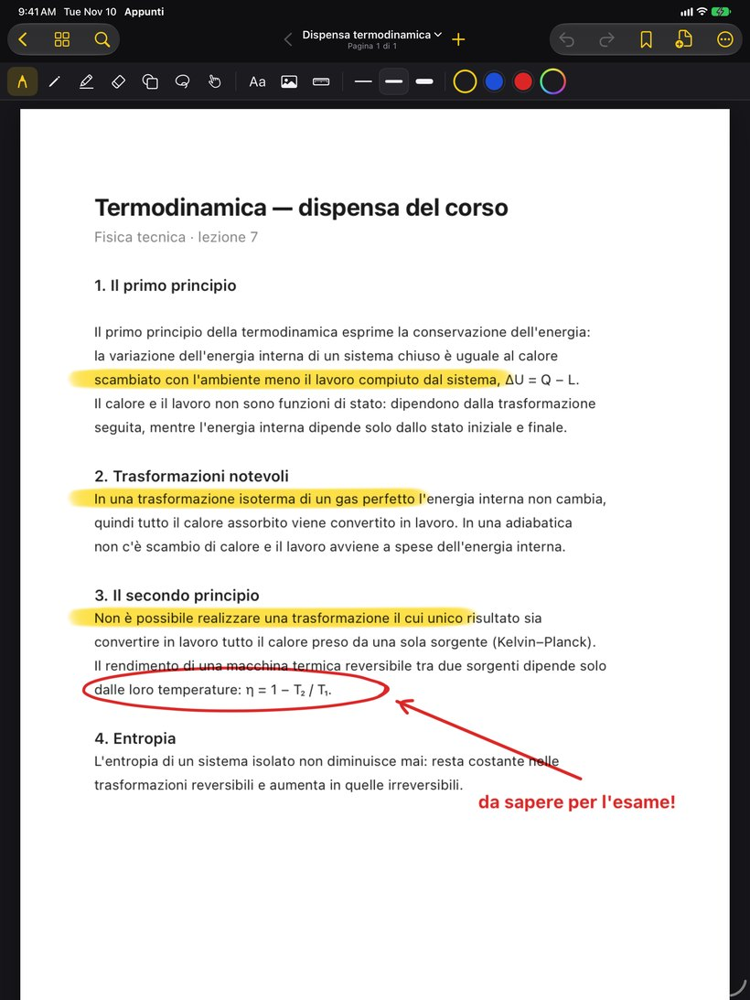 | 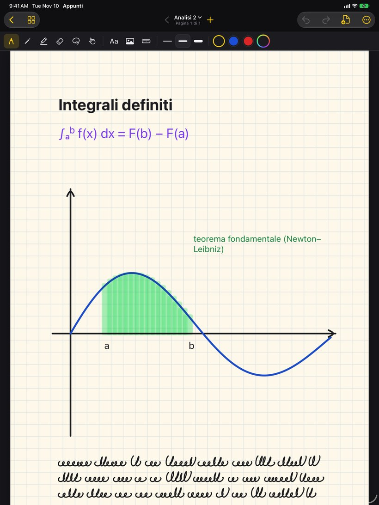 |
| PDF evidenziato e annotato | Carta a quadretti, grafico e area sotto la curva |
| 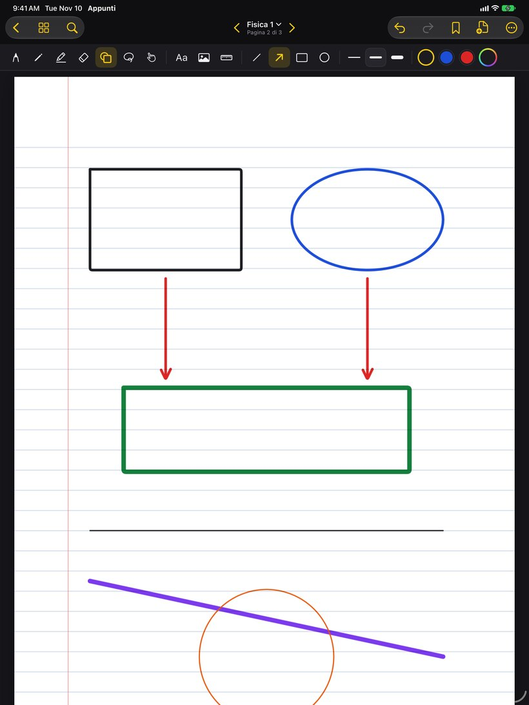 | 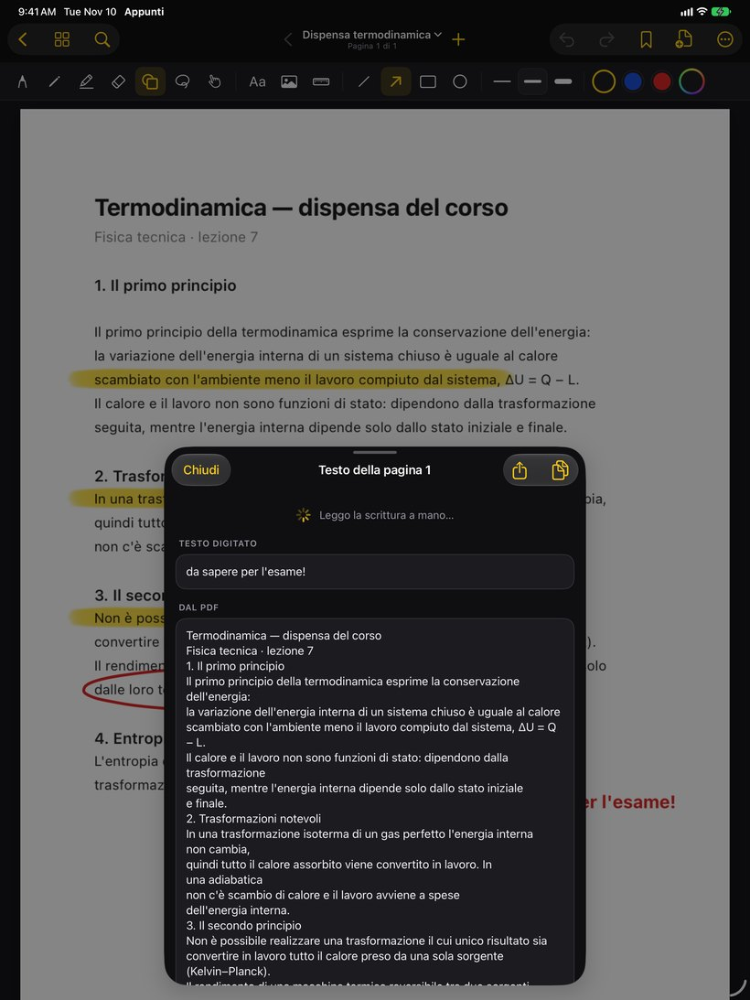 |
| Forme: rettangoli, ellissi, frecce e linee | Testo riconosciuto della pagina, da copiare |
| 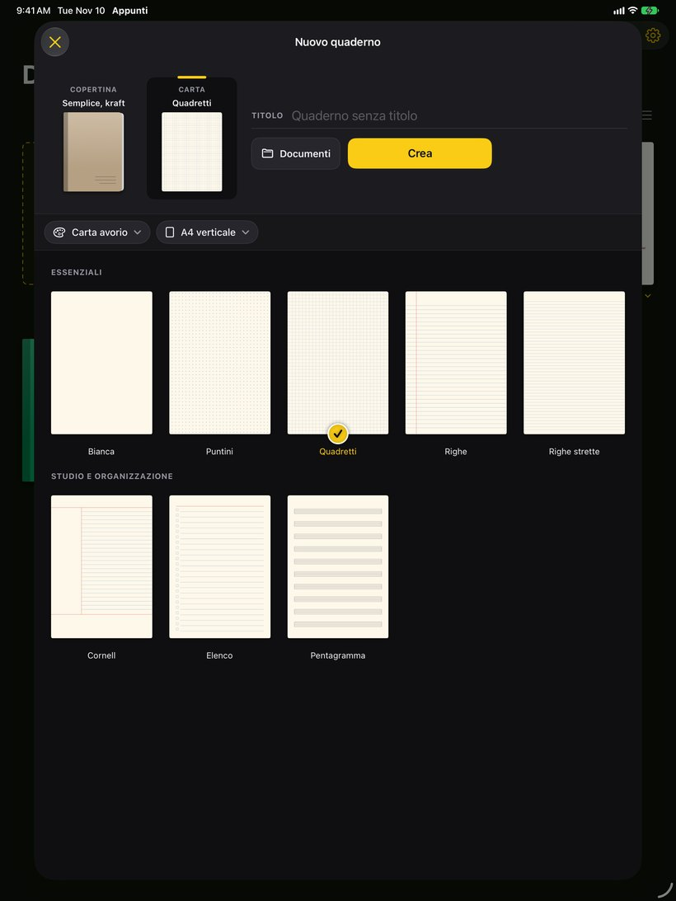 | 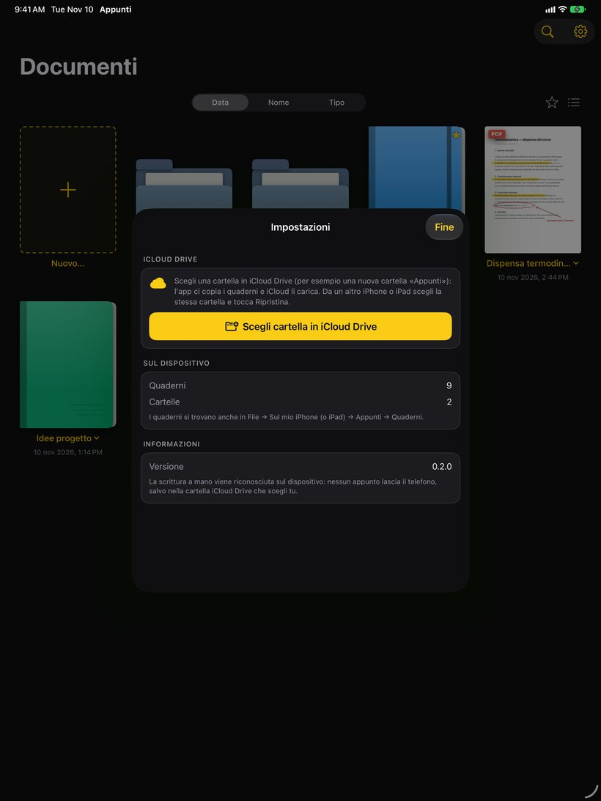 |
| Nuovo quaderno: copertina, carta e modelli | Impostazioni: salvataggio su iCloud Drive |

**iPhone Duo (chiuso)**

  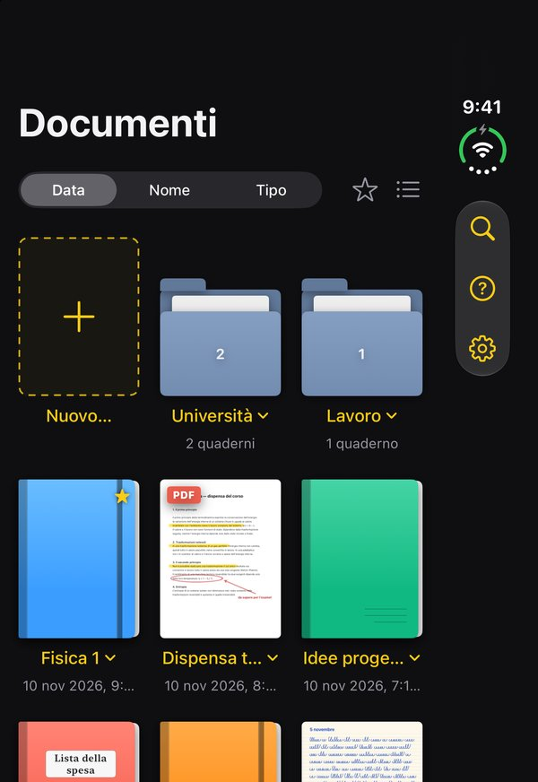
  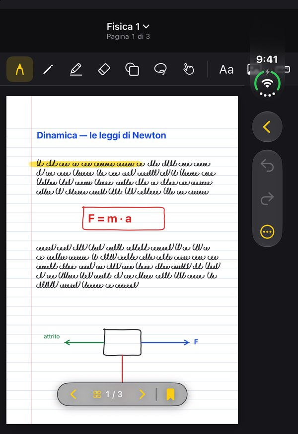
  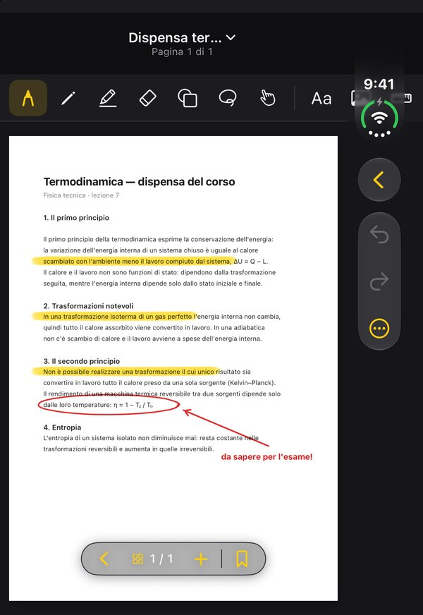
  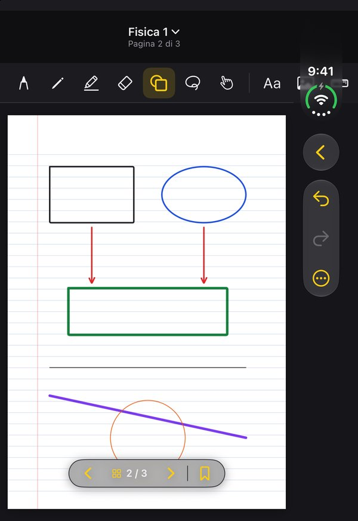

Schermate dal simulatore iOS con quaderni d'esempio (la scrittura a mano è finta).

## Cosa fa

- **Libreria** a griglia o a elenco, ordinata per data, nome o tipo; cartelle, preferiti e un
  menu sotto ogni quaderno (rinomina, copertina, sposta, etichette, duplica, esporta, elimina).
  **Etichette** (Scuola, Lavoro…) con i pulsanti sopra lo scaffale per vedere solo quelle.
  I quaderni eliminati restano 30 giorni nel **cestino** (Impostazioni → Cestino).
- **Copertine** classiche (semplici, con elastico o con etichetta) e illustrate (onde, mosaico,
  pois, marmo, foglie, montagne, notte stellata, terrazzo, aurora), in 13 colori, oppure la prima
  pagina.
- **Pagine** bianche, a puntini, a quadretti, a righe, a righe strette, Cornell, elenco con
  caselle o pentagramma; carta bianca, avorio, gialla o grigia; A4 verticale/orizzontale,
  Lettera o quadrato. Griglia delle pagine per saltare, duplicare, spostare o eliminare;
  **segnalibri** per ritrovare subito le pagine importanti, **collegamenti** da un riquadro o
  una foto a un'altra pagina e una **pagina indice** con l'elenco delle pagine, ogni riga un
  collegamento.
- **Barra strumenti** sempre in vista: penna, matita, evidenziatore, gomma (tratto intero,
  piccola, grande), **forme** (linea, freccia, rettangolo, ellisse), lazo, mano per spostare
  testi e foto, **puntatore laser**, righello; tre spessori e tre colori per strumento più un colore a scelta,
  ricordati tra un quaderno e l'altro. Zoom a due dita, annulla/ripeti. Si cambia pagina anche
  tirando oltre la fine del foglio. Su iPad si può scrivere solo con la Pencil e scorrere col
  dito; il doppio tocco sulla Pencil passa alla gomma e torna indietro.
- **PDF**: importa un PDF come nuovo quaderno (anche con "Apri con" dall'app File) o aggiungine
  le pagine a un quaderno esistente, e scrivici sopra. Un quaderno si crea anche da foto o
  **scansionando un documento** con la fotocamera.
- **Da GoodNotes**: un file `.goodnotes` (aperto con "Condividi" o dall'app File, oppure con
  + → Importa da GoodNotes) diventa un quaderno con pagine, carta, scrittura, evidenziatore,
  forme, foto e riquadri di testo.
- **Studio**: **nastro adesivo** da mettere su date, definizioni o risposte e da scoprire con un
  tocco; **flashcard** fatte con un riquadro sulla domanda e uno sulla risposta, da ripassare con
  la ripetizione dilazionata (Di nuovo, Difficile, Bene, Facile); **presentazione** con la sola
  pagina a tutto schermo e il puntatore laser.
- **Forme perfette**: una linea, un rettangolo, un triangolo o un cerchio disegnati a mano diventano
  puliti tenendo ferma la penna un attimo alla fine. **Testo dalla scrittura**: un riquadro su una
  parte scritta a mano la trasforma in testo, da correggere, copiare o mettere al posto della scrittura.
- **Adesivi**: un album con 22 adesivi pronti e quelli che crei tu con un riquadro su qualsiasi
  parte della pagina, con lo sfondo trasparente. **Lavagna infinita**: una sola pagina che si
  allarga mentre scrivi vicino ai bordi. Su iPad un quaderno si apre anche in una **finestra**
  sua, per tenerne due affiancati.
- **Livelli** in ogni pagina, da aggiungere, nascondere, rinominare e riordinare. **Documenti di
  testo** scritti con la tastiera, con stili, grassetto, elenchi, elenchi da spuntare e colori,
  da esportare in PDF, RTF o testo semplice.
- **Assistente** con Apple Intelligence sul dispositivo (iOS 26): riassunti della pagina o del
  quaderno, quiz da aggiungere alle flashcard e risposte alle domande sugli appunti, con le
  pagine citate. **Controllo dell'ortografia** della scrittura a mano: le parole sconosciute si
  sottolineano e si correggono con un tocco.
- **Quaderni condivisi** con altre persone attraverso una cartella condivisa di iCloud Drive,
  aggiornati ogni pochi secondi. **Agende** dell'anno con i mesi e le settimane collegati tra loro.
- **Testo e foto** sulla pagina: riquadri di testo (dimensione, grassetto, colore) e immagini,
  da trascinare e ridimensionare; **Incolla** mette sulla pagina il testo o l'immagine copiati.
- **Ricerca** nei titoli, nella scrittura a mano (riconosciuta sul dispositivo con Vision, in
  italiano e inglese), nei riquadri di testo e nel testo dei PDF, in tutta la libreria o solo
  nel quaderno aperto. **Testo riconosciuto** mostra il testo di una pagina, da copiare.
- **Registrazione audio** mentre scrivi, anche a schermo bloccato: toccando una parola scritta
  si sente cosa si diceva in quel momento.
- **Spotlight**: quaderni e testo delle pagine (anche scritto a mano) nella ricerca dell'iPhone.
- **Esporta** il quaderno o una pagina in PDF, o la pagina come immagine, da condividere,
  stampare o salvare in File.
- **Introduzione** in cinque schede al primo avvio, da rivedere quando si vuole dalle
  Impostazioni o dal "?" della libreria.
- In **italiano** e in **inglese**, secondo la lingua del dispositivo.

## Sincronizzazione con iCloud Drive

In *Impostazioni → Sincronizzazione con iCloud Drive* si sceglie una cartella (per esempio una
nuova cartella «Quaderno Appunti» in iCloud Drive), e la stessa cartella sugli altri iPhone e
iPad. L'app sincronizza quando si apre, dopo aver chiuso un quaderno e quando va in secondo
piano, oppure con *Sincronizza adesso*. Ogni file segue la sua copia più recente (due dispositivi
possono scrivere pagine diverse dello stesso quaderno), i quaderni eliminati spariscono anche
dagli altri dispositivi e il quaderno aperto nell'editor non viene mai sostituito mentre si scrive.

La sincronizzazione iCloud automatica di Apple richiede un account sviluppatore a pagamento e
non funziona con le app installate con Feather o Sideloadly; una cartella scelta in File invece
funziona sempre. I quaderni restano comunque anche sul dispositivo, in
*File → Sul mio iPhone → Quaderno Appunti → Quaderni*.

## Compilare

Nessun Mac necessario: `.github/workflows/ipa.yml` genera il progetto con XcodeGen e produce
`Quaderno-Appunti-<versione>-unsigned.ipa` (artefatto `appunti-ipa`), da installare con Feather,
Sideloadly o AltStore. Nuova versione: aumentare `MARKETING_VERSION` in `project.yml`.

`.github/workflows/testflight.yml` carica la stessa versione su TestFlight (identificativo
`win.shadowbyte.appunti`) a ogni release `v…`, firmandola con la chiave API di App Store Connect
salvata nei secret del repository.

Le schermate qui sopra le fa `.github/workflows/screenshots.yml` (avvio manuale): compila per il
simulatore e lancia `scripts/screenshots.sh`, che apre l'app con `-demo -screen <nome>` su un
iPhone e un iPad con dei quaderni d'esempio.
